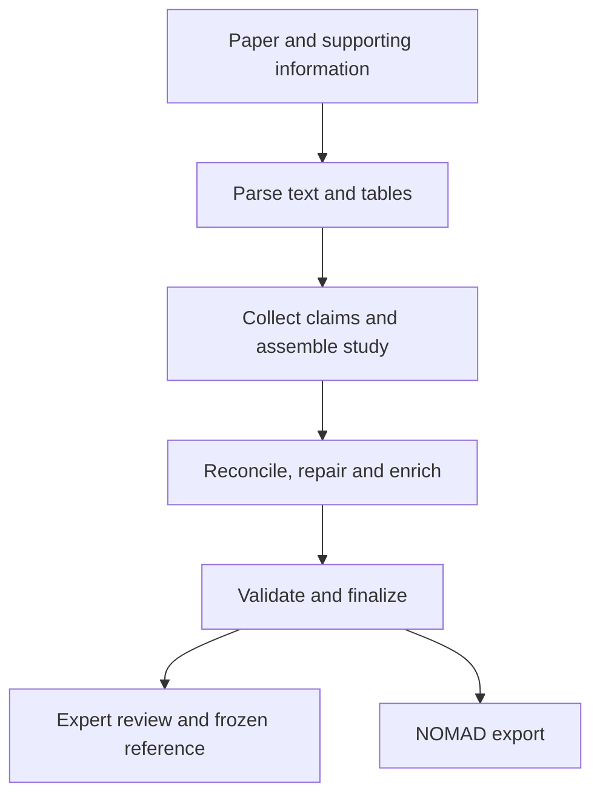

<!-- generated-by: gsd-doc-writer -->
# PERLA Extract

PERLA Extract turns photovoltaic papers and supporting information into source-linked
records for device structure, composition, processing, performance and stability.
It represents individual measurements separately from population statistics and
stability tests. Experts still need to check attribution, interpretation and completeness.

## Workflow

The parser retains source, page, text and available coordinates. Models select
evidence-span IDs; the application restores exact quotations. Source checks detect
invalid citations, absent raw values, duplicate identifiers and broken links. They
do not establish that a passage scientifically supports a claim.

Finalization can remove unsupported optional claims. It preserves the complete
candidate and a list of removals for expert review.
See [Evidence and validation](concepts/evidence.md) for the checks and their limits.

For evaluation, start with [Evaluation method](methods/benchmark.md) or
[run the synthetic scoring example](workflows/scoring-example.md).

## How extraction works

Models collect claims before assembling records. Long documents can be split at
structural boundaries and read more than once; one global call assembles the cited
claims. A later pass checks the draft against the evidence. Saved drafts and change
reports let you inspect what each pass changed.

Claims distinguish device designs, processing variants, specimens and measurements.
Layers and processing steps use `ReportedValue` for individual quantities, with
shared citation IDs to avoid repeating quotations. The output retains failed
responses, configuration and export losses alongside the final study.

## Choose a path

- [Run your first extraction](getting-started.md)
- [Discover new papers with PapersBot](workflows/papersbot.md)
- [Understand the study model](concepts/study-model.md)
- [Understand evidence validation](concepts/evidence.md)
- [Review and curate ground truth](workflows/ground-truth-review.md)
- [Score rich extractions deterministically](workflows/evaluation.md)
- [Extract a batch for review](workflows/quality-first-ground-truth.md)
- [Interpret composition and processing](workflows/enrichment.md)
- [Export directly to NOMAD](workflows/nomad-export.md)
- [Export to the historical reduced PERLA schema](compatibility/reduced-schema.md)
