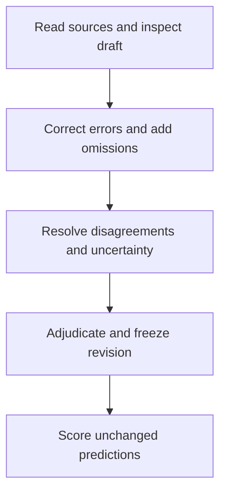

# Evaluation method

PERLA compares an extraction with a source-checked reference. A fact receives credit
when both its value and its experimental context agree: PCE = 20% on a reverse scan
does not match the same value assigned to a forward scan.

The scorer is deterministic and makes no model calls. Start with the
[worked example](../workflows/scoring-example.md) to run it without papers or an API
key. The [scoring reference](../workflows/evaluation.md) documents the exact matching,
tolerance and reporting rules.

## Inputs

An evaluation uses two `StudyExtraction` documents:

- Reference: the source-checked records used as the comparison target.
- Prediction: the unchanged extraction being evaluated.

A frozen reference directory records the reviewed version, its schema and content
hashes and the final review decisions. A complete prediction
directory includes source evidence and saved call, token, cost and timing totals.
Bare JSON inputs are also accepted, but lack these checks and supporting records.
The repository includes a [30-paper expert-reviewed development release](https://github.com/lamalab-org/perla-extract/tree/main/data/study_extraction/ground_truth/v2).
Its public manifests omit private review history and identities. The separate
executable scoring example uses synthetic data.

Reference and prediction must cover the same sources and scientific scope. The
extraction workflow reads parser-produced text and tables. Figure classification
is separate; classifying a panel does not create reference labels for its values.

## Construct the reference

Experts read the main paper and supporting information, correct proposed records,
and add omitted information. Corrections and source-wide omission checks are both
needed: approving the records already present does not establish completeness.

Families, individual specimens, observations, population summaries and stability
tests remain separate. Reverse and forward scans can describe one cell; a mean over
20 cells is a population result. A stability specimen is linked to another measured
cell only when the source supports that identity.

The workbench saves corrections, additions, decisions and their evidence. An
authorized finalizer approves the records before export. Administrators have this
permission by default; deployments can also grant it to signed-in reviewers through
`REVIEW_ALLOW_REVIEWER_FINALIZATION=true`.
The exporter checks
that every current record has a final decision and that the schema and citations
pass validation. It cannot tell whether a reviewer read the whole source or
interpreted it correctly. The [review-to-benchmark guide](
../workflows/review-to-benchmark.md) explains how to reconcile feedback and freeze it.

Reviewers can leave records uncertain while working, but final adjudication and
export require verified decisions for every current record. The scorer rejects
references that still declare uncertain records. Every system is compared with the
same fixed reference; no predictions are excluded to accommodate reviewer uncertainty.

Verification means the record faithfully represents the source. A source-reported
range or an unknown specimen link can be a verified fact. If the source cannot
resolve a disputed claim, keep the paper pending rather than inventing certainty.
Report pending papers separately from the finalized benchmark.

## Match records, then compare facts

Two extractions may give the same device different IDs. PERLA therefore pairs
records by content within each record type. Family and device pairings, together
with measurement conditions, help pair their child records. Each prediction can
match only one reference record.

Family matching uses structure, composition and variant; missing recipes or
measured properties lose their own credit without changing family identity.
Device/measurement identity uses declared specimen and protocol fields, excluding
outcomes, metric names and annotation completeness. Indistinguishable repeated
measurements remain ambiguous even when their values differ.
Population cohort labels (unless both sides supply structured treatment identity),
and stability specimen labels without explicit
device links, must agree. This prevents equal outcomes from making a control and a
treated cohort interchangeable. The rule normalizes typography, not synonyms, so
different descriptions of the same cohort can still lose credit. Checked label
equivalences can be supplied explicitly, tied to an exact reference hash. Freeze
these decisions before comparing models and use the same list for every arm.

The primary score requires correctly attributed facts. A separate information-
recovery view matches compatible concepts across individual/population containers.
Both retain one-to-one assignment and the same denominators. Four reporting domains
cover performance, material/device identity, processing and stability. Qualitative
observations, unparsed measurement claims and statistical metadata have separate
breakdowns; they must not be labeled numerical performance measurements. Context identifies
the cell, scan, layer, constituent, operation or stability checkpoint. Explicit
sequence fields determine layer and operation order; JSON array position does not.
Fully ordered recipes align by operation and target with gaps. Only step pairs shared
by every optimal order-preserving alignment receive contextual credit. Conditions
cannot break a tie. Equal properties and constituents duplicated across a layer and
its sole explicitly linked absorber count once, with all original paths retained;
conflicting quantities are flagged. Copies within one list remain extra facts.

Single unqualified numbers with compatible explicit units are converted before
comparison. The default relative tolerance is **1% (`0.01`)**, with no absolute
allowance, to accommodate modest rounding differences. The allowance scales with
the converted magnitude; it applies to reported values and numeric context, with
temperature expressed in kelvin. It does not represent experimental uncertainty.
Use `--numeric-relative-tolerance 1e-6` for a stricter sensitivity analysis. Freeze
the chosen tolerance across all arms; it is recorded in each report. Ranges and
symmetric uncertainties compare both components after conversion. Simple chemical
formulas accept numeric LaTeX subscripts. Checked material names and redundant
layer-property qualifiers are normalized by a small versioned vocabulary;
unfamiliar descriptions remain literal. Printed powers of ten and explicit
ohms-per-square notation are recognized. A unit explicitly present in a raw scalar,
range or uncertainty can supply a missing unit field, but conflicting supplied
fields are not repaired.
The [scoring reference](../workflows/evaluation.md)
gives examples and the full matching algorithm.

## Read the results

| Result | Question answered |
| --- | --- |
| Correct value in correct context | Do the value and its recorded context match the reference? |
| Information recovery | Was the compatible concept/value recovered anywhere in this paper, including across individual/population containers? |
| Citation validation | Do the cited passages and raw values occur in the supplied evidence? |

For each scientific group, the report includes reference, predicted and matched
fact counts, precision, recall and F1. A wrong value contributes an unmatched
prediction and an unmatched reference fact. Extra predictions reduce precision;
missing facts reduce recall. Duplicate predictions cannot reuse one reference fact.

The per-paper summary is attributed micro F1 over its eligible fact inventory.
Papers receive equal weight in study comparisons. Domain/subfield scores accompany
that summary; frequent fact types still receive more weight within a paper.
Unreviewed reference coverage limits these numbers to diagnostic agreement.

The dataset command combines paper reports that use compatible versions and scoring
settings. It estimates uncertainty in average scores by resampling papers, keeping
each paper's fields together. These intervals describe one system, not the difference between
two systems. Pass `--release` with the frozen `release.json` to require every listed
paper and its exact reference hash. The command then refuses an incomplete or mixed
reference set. It retains the input report hashes in the aggregate. Missing or failed
runs still need an explicit resolution; the command does not invent their predictions.

## Limitations

Record matching is an estimate of identity. Similar specimens or differently grouped
operations can produce incorrect pairings. The report lists selected pairs,
unmatched fields and detected ambiguity so you can check them against the source.
A pairing can be wrong even when the scorer gives no warning. Eight papers in the
frozen v2 development release contain measurement identities the current policy
cannot distinguish in a self-comparison. Their affected facts remain in denominators
and are flagged for review; they are not silently omitted or identified by outcomes.
Ambiguity checks detect changes between equally optimal complete assignments, not
just ties between two local candidates. They do not measure how plausible a pairing
is scientifically. If families are distinguishable only by their recipes, excluding
recipes from family matching can expose an ambiguity rather than settle it.

The fixed text-comparison rules can reject equivalent chemical names or descriptions. Conversely, literal presence in a citation does not prove that a value belongs
to the asserted device or property. Citation validity and scientific correctness are
therefore reported separately.

Precision and recall are relative to the reference's reviewed scope and completeness.
A perfect score against an incomplete reference does not establish complete extraction
from the paper. Regression tests and the synthetic example check software behavior;
they do not measure agreement with experts on arbitrary papers.

## Reproduce a score

Keep the reference, prediction, evidence, code revision and scoring configuration
with the result. Reports record input hashes and scorer versions; the example also
records its environment. Reusing fixed inputs and configuration reproduces the
deterministic comparison.

When reference labels change, freeze a new revision and rescore saved predictions
against that revision. Do not compare scores based on different reference versions
as if only the extractor had changed.

## Coverage and the current summary statistic

Schema 7 adds optional structured subject context, population protocol and error-bar
meaning. Archived schema-6 references load with unknown defaults; their bytes and
review history remain unchanged. Ground-truth format 4 remains the single format.

Evaluation format 11 replaces the previous group-macro headline with per-paper
attributed fact micro F1. Study comparisons average repeats within each paper and
then take an equal-paper mean of paired differences, with paper resampling. Pooled
P/R/F1 and domain breakdowns accompany it. This method change requires rescoring
all arms; old and new scores are not directly comparable.

Exported reference coverage declares text/tables, figures and attribution context
by domain. Unreviewed or incomplete scope yields diagnostic reference agreement,
including recall only against the annotated subset. It cannot establish extraction
precision against all reported claims. Comparisons withhold verified quality
conclusions until coverage is reviewed. Software self-tests do not replace
independent source-based calibration or held-out validation.
