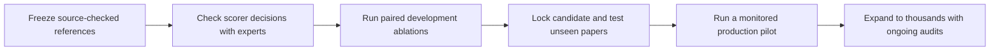

# Validate before scaling

PERLA needs three different kinds of evidence: trustworthy reference records, a
scorer that agrees with scientific judgments, and experiments that measure quality
and cost fairly. Passing a software test does not substitute for any missing
scientific review. This page separates what is implemented from what still needs
measurement.



## 1. Know what the reference establishes

The public v2 release contains 30 model-assisted, finalized **development** references.
These papers have informed extraction and scoring changes. Do not relabel a subset
as held out now: its feedback has already influenced the system.

An audit with matcher v7 on 28 October 2026 counted:

| Scientific group | Scored facts | Papers with at least one fact |
| --- | ---: | ---: |
| Performance | 1,947 | 29 |
| Population statistics | 560 | 28 |
| Stability | 1,152 | 23 |
| Composition | 3,430 | 30 |
| Stack | 2,200 | 30 |
| Processing | 5,209 | 30 |

These are scorer-defined facts, not independent experimental replicates. They come
from 134 families, 340 individual devices, 432 performance observations, 142
population summaries and 107 stability tests. All references passed self-comparison.
This checks consistency; it does not establish source completeness or a model's accuracy.

All 30 public manifests declare adjudication. Four retain a completeness-stage
marker. The other 26 are **not automatically unreviewed**: trusted-review adoption
and revision history can represent review differently. But the public manifest alone
does not establish a source-wide omission search for those records. Reconcile this
with the existing private review history before claiming uniform completeness.
Do not ask experts to redo work that the history already documents. Where evidence
is genuinely absent, request a focused source-coverage check and retain the result.

Repeat the software audit without PDFs, API keys or model calls:

```bash
PYTHONPATH=.:src python -m examples.ablations.references \
  --release data/study_extraction/ground_truth/v2/release.json \
  --output /absolute/path/to/new/reference-audit.json
```

The command checks reference and manifest hashes, finalization declarations,
scorer self-consistency and the complete roster. It reports group coverage and
review-stage metadata. It does not reopen the private source documents, verify the
identity of a reviewer, or certify every scientific statement. Existing audit files
are never overwritten.

The `reference-release` CI job repeats this audit and saves the sanitized JSON as
the `reference-audit-v2` workflow artifact. It contains no PDFs or reviewer identities.

Keep original uploads, comments, before/after edits and final decisions in the
private archive. Publish only sanitized releases. A supported correction creates a
new version; it never rewrites the old reference or a saved prediction. Do not
repair references merely to increase a model score.

## 2. Validate the scorer against scientific decisions

The deterministic scorer checks values **and** context. Its tests cover unit
conversion, missing and extra records, wrong outcomes, control/treatment swaps,
recipe omission, renamed IDs, order invariance and assignment ambiguity. The
assignment implementation is also checked against exhaustive small-matrix solutions.
The [scoring reference](../workflows/evaluation.md) states the exact tolerances.

Before ranking models, an expert should inspect a prespecified sample of both
accepted and rejected matches, covering all six groups. Include genuine model
outputs, not only synthetic examples. Show source evidence and both records, but
hide the model name and whether the cheaper arm produced them where practical.
Ask separately:

1. Do these records refer to the same device, cohort or experiment?
2. Are these values scientifically equivalent, with the same qualification and units?
3. Is the value attached to the correct material, protocol and statistical level?

Record the expected decisions before showing the scorer's result. Report false
accepted matches and false rejected equivalents separately, by group. Review a
small random sample as well as suspected failures; inspecting only flagged cases
cannot estimate the scorer's error rate. Keep sampling probabilities if using the
sample to estimate population rates.

Particular limitations need this check: chemical synonyms, cohort-label paraphrases,
recipe grouping and very similar specimens. Text equality is intentionally
conservative; there is no calibrated semantic judge. Enriched A/B/X ion assignments
and the correctness of NOMAD exports are not covered by the six core scores.
Test those outputs separately before claiming equivalent downstream chemistry.

A scorer change requires rescoring **all** compared systems with that version.
Keep algorithm changes separate from reference amendments. Do not tune tolerances
or manual pairings to favor a candidate.

## 3. Compare one choice at a time

The [four ablation studies](../workflows/extraction-ablations.md) already isolate:

| Study | Changed choice | Kept fixed |
| --- | --- | --- |
| 1 | One versus two source readings | Models and downstream stages |
| 2 | Global refinement on/off | Readings, repair and enrichment |
| 3 | Claim ledger versus direct source input | Other enabled stages and budgets |
| 4 | Cheaper claim reader | Strong assembly, repair, refinement and enrichment |

Preparation makes no paid calls. It validates references, verifies input PDF/SI
hashes, freezes the cohort and scorer, randomizes arm order and separates model
caches. Comparison checks each run's saved settings against its prepared settings,
including CLI defaults, model choices, stage switches, budgets and prompt/schema hashes.
A full-release plan refuses missing papers. A smaller prespecified pilot
remains a pilot, not a full benchmark. Record installed dependency versions and
provider settings with the clean code revision; neither hashes nor a model name
guarantee unchanged hosted weights or provider defaults.

Use paired paper-level differences and all six groups' precision/recall/counts.
Average repeated runs within papers; do not treat thousands of fields or repeated
calls as thousands of independent papers. The comparison report includes a
descriptive paper-level paired bootstrap interval, but does not declare equivalence
or select a production winner. Report failure and citation-validation rates as well
as scores. Unknown cost is not zero; include repairs, failed attempts and provider
cache usage in accounting.

Never drop a long SI or malformed output because it lowers a candidate's score.
If a run cannot be scored, keep its failure visible and apply the same prespecified
retry rule to both arms. Until the full roster has a justified outcome, withhold a
complete-comparison claim. Do not select the best stochastic repetition.

Development comparisons are for choosing what to test next. Repeatedly selecting
the best observed score can overfit the evaluation sample, even without model
training. See [Cawley and Talbot](https://www.jmlr.org/papers/v11/cawley10a.html).
Choice of paired testing and the evaluation unit also matters; see
[Dror et al.](https://aclanthology.org/P18-1128/). Neither reference supplies a
universal acceptable quality-loss margin for this scientific application.

## 4. Require new evidence before scaling

After development, freeze one candidate and compare it with the control on newly
reviewed papers not used for prompt, scorer or workflow choices. Select papers for
the intended corpus: publication periods and publishers, long and short SI, complex
chemistry, population/stability results, scanned pages and figure-heavy reporting.
The number needed depends on observed variation and the quality-loss margin agreed
in advance; 30 development papers do not supply a universal sample-size guarantee.

For the untouched set, have reviewers check source coverage independently of the
candidate output and adjudicate disagreements. Model-assisted references can be used,
but a source-first omission check is essential. Record text/table versus figure-only
availability: the extraction workflow does not read figure images. Score against the
declared reference scope and report that limitation; do not invent or silently mask
figure-only values after seeing results.

Only then run a monitored production pilot. Expand after it meets prespecified
quality, failure-rate and cost criteria. Preserve each attempt and its configuration,
keep retries bounded and logged, verify resume/cache inputs, and impose concurrency
and campaign-spend controls. The current per-run budget is checked between provider
calls; it is **not** a guaranteed hard campaign cap. Do not launch thousands of jobs
on the assumption that a pilot's token price is its all-in per-paper cost.

Continue random scientific spot checks, plus targeted checks on parser failures,
long SI, unusual chemistry and changed providers. Keep those targeted samples
separate from estimates of average corpus accuracy. New failure modes return to the
development set; they do not retroactively turn old experiments into held-out tests.

## Readiness, without overclaiming

| Layer | Implemented evidence | What remains scientific or operational work |
| --- | --- | --- |
| Reference | Versioned exports, preserved corrections, integrity checks, explicit metadata audit | Reconcile source-coverage provenance; targeted checks where that evidence is absent |
| Scorer | Deterministic contracts, adversarial controls, exact input/version accounting | Measure agreement with experts on actual predictions and semantic edge cases |
| Ablations | Paired frozen plans, source checks, complete-roster reporting, cost visibility | Run authorized experiments, inspect errors, lock a candidate |
| Scale | Existing batch/shard tools and bounded per-run calls | Untouched-paper evaluation, safe campaign operation, production pilot and ongoing audits |

This is a foundation for defensible experiments, not a claim that an extractor has
already been validated for thousands of papers.
