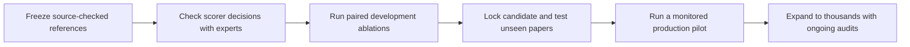

# Validate before scaling

Before scaling, check the reference records, compare scorer decisions with expert
judgments, and measure extraction quality and cost. Software tests cover only part
of this work.



## 1. Know what the reference establishes

The public v2 release contains 30 model-assisted, finalized development references.
These papers have informed extraction and scoring changes. Do not relabel a subset
as held out now: its feedback has already influenced the system.

An audit with matcher v7 on 28 October 2026 counted:

| Scientific group | Scored facts | Papers with at least one fact |
| --- | ---: | ---: |
| Performance | 1,947 | 29 |
| Population statistics | 560 | 28 |
| Stability | 1,152 | 23 |
| Composition | 3,430 | 30 |
| Stack | 2,200 | 30 |
| Processing | 5,209 | 30 |

These are scorer-defined facts, not independent experimental replicates. They come
from 134 families, 340 individual devices, 432 performance observations, 142
population summaries and 107 stability tests. All references passed self-comparison.
This checks consistency; it does not establish source completeness or a model's accuracy.

All 30 public manifests declare adjudication; four retain a completeness-stage
marker. Trusted-review adoption can record completion differently, so missing markers
do not mean missing review. Check the private history before claiming uniform
source coverage. Request a focused omission check only where that history does not
document one.

Repeat the software audit without PDFs, API keys or model calls:

```bash
PYTHONPATH=.:src python -m examples.scoring.reference_audit \
  --release data/study_extraction/ground_truth/v2/release.json \
  --output /absolute/path/to/new/reference-audit.json
```

The command checks reference and manifest hashes, finalization declarations,
scorer self-consistency and the complete roster. It reports group coverage and
review-stage metadata. It does not reopen the private source documents, verify the
identity of a reviewer, or certify every scientific statement. Existing audit files
are never overwritten.

The `reference-release` CI job repeats this audit and saves the sanitized JSON as
the `reference-audit-v2` workflow artifact. It contains no PDFs or reviewer identities.

Keep original uploads, comments, before/after edits and final decisions in the
private archive. Publish only sanitized releases. A supported correction creates a
new version; it never rewrites the old reference or a saved prediction. Do not
repair references merely to increase a model score.

## 2. Validate the scorer against scientific decisions

The deterministic scorer checks values and context. Its tests cover unit
conversion, missing and extra records, wrong outcomes, control/treatment swaps,
recipe omission, renamed IDs, order invariance and assignment ambiguity. The
assignment implementation is also checked against exhaustive small-matrix solutions.
The [scoring reference](../workflows/evaluation.md) states the exact tolerances.

Before ranking models, an expert should inspect a prespecified sample of both
accepted and rejected matches, covering all six groups. Include genuine model
outputs, not only synthetic examples. Show source evidence and both records, but
hide the model name and whether the cheaper arm produced them where practical.
Ask separately:

1. Do these records refer to the same device, cohort or experiment?
2. Are these values scientifically equivalent, with the same qualification and units?
3. Is the value attached to the correct material, protocol and statistical level?

Record the expected decisions before showing the scorer's result. Report false
accepted matches and false rejected equivalents separately, by group. Review a
small random sample as well as suspected failures; inspecting only flagged cases
cannot estimate the scorer's error rate. Keep sampling probabilities if using the
sample to estimate population rates.

Particular limitations need this check: chemical synonyms, cohort-label paraphrases,
recipe grouping and very similar specimens. Text equality is intentionally
conservative; there is no calibrated semantic judge. Enriched A/B/X ion assignments
and the correctness of NOMAD exports are not covered by the six core scores.
Test those outputs separately before claiming equivalent downstream chemistry.

A scorer change requires rescoring all compared systems with that version.
Keep algorithm changes separate from reference amendments. Do not tune tolerances
or manual pairings to favor a candidate.

### Prepare a sample for independent experts

From the repository root, use the scoring environment to sample an already scored
run. Choose papers, runs, the sample size and seed before inspecting individual
scorer errors:

```bash
PYTHONPATH=.:src python -m examples.scoring.sample_review \
  --truth data/study_extraction/ground_truth/v2/dev/PAPER_ID \
  --prediction runs/PAPER_ID/control-1 \
  --per-stratum 5 --seed 17 --output calibration/anonymous-candidate-01
```

The command verifies that `evaluation.json` matches the reference and sealed run.
It samples without replacement within each scientific group and whether the scorer
awarded credit. Each nonempty stratum contributes at most `--per-stratum` fields.
An existing output directory is refused. It makes no model calls and supplies no
expert labels.

Give reviewers **only `review/`**, plus the original PDF and SI. It contains complete
`candidate.json` and `reference.json` scientific records, and `judgments.csv` listing
the sampled prediction paths in shuffled order. Filenames and the CSV omit the model
name, arm and scorer decisions. Check that scientific prose does not itself reveal
the candidate's origin. Keep `analyst-key.json` private until judgments are locked;
it binds the sample to input hashes and retains credit decisions, stratum sizes and
inclusion probabilities. Give each reviewer a separate copy and adjudicate disagreements.

For each path, inspect the full linked records and sources. Fill the first five
judgment fields with `yes`, `no` or `uncertain`:

| Field | Question |
| --- | --- |
| `same_identity` | Does the candidate describe the same device, cohort or experiment as a reference counterpart? |
| `equivalent_value` | Do value, units and qualifiers express the same scientific claim? |
| `correct_attribution` | Is it assigned to the correct material, protocol and statistical level? |
| `credit_should_be_awarded` | Should this field earn credit under the declared value-and-context, one-to-one matching rule? |
| `reference_supported` | Does source evidence support the reference used for this judgment? |

Use `source_accessibility` values `text_or_table`, `figure_only`, `both` or `uncertain`.
Add a main/SI page or figure identifier in `source_location` and explain disagreement
or uncertainty in `reason`. Do not copy the scorer's decision into these columns.
This sample evaluates credit for **predicted fields**; it does not measure recall
or establish that the reference covers all source information. Run a separate
source-first omission audit for those questions.

After locking judgments, join them to the analyst key by `item_id`. Report incorrect
credit among sampled awarded fields and missed credit among sampled denied fields,
separately for every group. Unequal stratum sampling needs weights of
`1 / inclusion_probability` to estimate rates within the sampled runs. Report
uncertain judgments and reference defects separately; do not silently turn them
into correct decisions. Choosing papers purposively does not support corpus-wide
error rates, and fields within a paper are not independent replicates.

To rehearse the mechanics without claiming expert validation, run the
[offline scoring example](../workflows/scoring-example.md), then use its
`truth/dev/10.0000--synthetic` and `predictions/wrong_scan` directories as inputs.
The resulting judgment columns remain empty until a person reviews them.

## 3. Compare one choice at a time

First test whether the full pipeline improves on direct source-to-study extraction.
In `experiment.toml`, set `use_claim_ledger`, `use_refinement`, `use_targeted_repair`
and `use_enrichment` to `false` under `[control]` and `true` under `[treatment]`.
Hold model, parser, source scope and resource limits fixed. A direct
request that exceeds its context budget is a retained failure, not permission to
truncate the source or remove that paper. This combined comparison establishes a
baseline; it cannot attribute a difference to any one stage.

The [four ablation studies](../workflows/extraction-ablations.md) isolate:

| Study | Changed choice | Kept fixed |
| --- | --- | --- |
| 1 | One versus two source readings | Models and downstream stages |
| 2 | Global refinement on/off | Readings, repair and enrichment |
| 3 | Claim ledger versus direct source input | Other enabled stages and budgets |
| 4 | Cheaper claim reader | Strong assembly, repair, refinement and enrichment |

Report the quality/resource tradeoff at the declared limits. If also asking whether
a stage helps at equal expenditure, run a separate budget-matched study and state
the matching rule in advance. An extra reading can improve results simply by using
more computation. Enrichment's downstream utility requires its own scientific
outcomes; core extraction F1 does not validate the interpreted chemistry.

Before running, commit `experiment.toml` with the selected sources/references,
repeat count and both arms' settings, as shown in the
[experiment guide](../workflows/extraction-ablations.md). Keep the scorer version,
retry policy and primary comparison in the same versioned study protocol.
`perla-experiment` freezes the derived study and complete roster before execution,
shuffles execution order using the saved `order_seed` (default 0), and separates
response caches. It stops if source, reference or configuration files change during
the campaign. It does not rerun failed attempts automatically.

Its comparison step verifies saved run artifacts, requires the same
source and evidence hashes within each pair, checks scorer/reference compatibility,
and rejects settings that differ outside the declared factors. It compares the CSV
with every declared paper/repeat, checks the expected value of each factor in each
arm, and requires consistent settings within each arm across papers and repeats.
Omitting a whole pair or reversing the intervention blocks quality aggregation.
The full declaration and its hash accompany the results. These checks cannot prove
that the protocol was written prospectively or that the references are correct.
For full-release dataset reporting, `perla-evaluate-dataset --release` separately
enforces the published roster and reference hashes.

A smaller prespecified pilot remains a pilot, not a full benchmark. Record installed
dependency versions and provider settings with the clean code revision; neither
hashes nor a model name guarantee unchanged hosted weights or provider defaults.

Use paired paper-level differences and all six groups' precision/recall/counts.
Average repeated runs within papers; do not treat thousands of fields or repeated
calls as thousands of independent papers. The comparison report includes a
descriptive paper-level paired bootstrap interval, but does not declare equivalence
or select a production winner. Report failure and citation-validation rates as well
as scores. Unknown cost is not zero; include repairs, failed attempts and provider
cache usage in accounting.

Never drop a long SI or malformed output because it lowers a candidate's score.
If a run cannot be scored, keep its failure visible and apply the same prespecified
retry rule to both arms. Until the full roster has a justified outcome, withhold a
complete-comparison claim. Do not select the best stochastic repetition.

Development comparisons are for choosing what to test next. Repeatedly selecting
the best observed score can overfit the evaluation sample, even without model
training. See [Cawley and Talbot](https://www.jmlr.org/papers/v11/cawley10a.html).
Choice of paired testing and the evaluation unit also matters; see
[Dror et al.](https://aclanthology.org/P18-1128/). Neither reference supplies a
universal acceptable quality-loss margin for this scientific application.

## 4. Require new evidence before scaling

After development, freeze one candidate and compare it with the control on newly
reviewed papers not used for prompt, scorer or workflow choices. Select papers for
the intended corpus: publication periods and publishers, long and short SI, complex
chemistry, population/stability results, scanned pages and figure-heavy reporting.
The number needed depends on observed variation and the quality-loss margin agreed
in advance; 30 development papers do not supply a universal sample-size guarantee.

For the untouched set, have reviewers check source coverage independently of the
candidate output and adjudicate disagreements. Model-assisted references can be used,
but a source-first omission check is essential. Record text/table versus figure-only
availability: the extraction workflow does not read figure images. Score against the
declared reference scope and report that limitation; do not invent or silently mask
figure-only values after seeing results.

Only then run a monitored production pilot. Expand after it meets prespecified
quality, failure-rate and cost criteria. Preserve each attempt and its configuration,
keep retries bounded and logged, verify resume/cache inputs, and impose concurrency
and campaign-spend controls. The current per-run budget is checked between provider
calls; it is not a hard campaign cap. Do not launch thousands of jobs
on the assumption that a pilot's token price is its all-in per-paper cost.

Continue random scientific spot checks, plus targeted checks on parser failures,
long SI, unusual chemistry and changed providers. Keep those targeted samples
separate from estimates of average corpus accuracy. New failure modes return to the
development set; they do not retroactively turn old experiments into held-out tests.

## What is ready and what remains

| Layer | Implemented evidence | What remains scientific or operational work |
| --- | --- | --- |
| Reference | Versioned exports, preserved corrections, integrity checks, explicit metadata audit | Reconcile source-coverage provenance; targeted checks where that evidence is absent |
| Scorer | Deterministic contracts, adversarial controls, exact input/version accounting | Measure agreement with experts on actual predictions and semantic edge cases |
| Ablations | Required cohort/repeat/arm declarations, coverage and setting checks, paired reporting, cost visibility | Freeze the study prospectively, run real experiments and inspect errors |
| Scale | Existing batch/shard tools and bounded per-run calls | Untouched-paper evaluation, safe campaign operation, production pilot and ongoing audits |

Extraction accuracy and cost at corpus scale still need to be measured.
